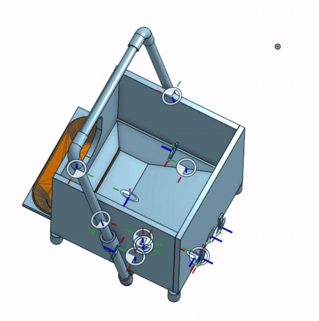
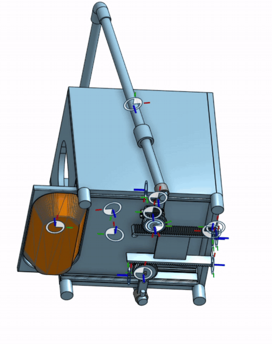
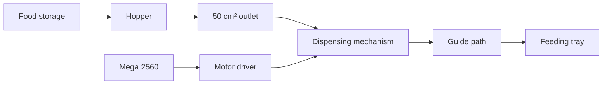

# Automatic Cat Feeder

## Physical prototype and mechanism animations

### Physical feeder demonstration

https://github.com/user-attachments/assets/c59baec1-f67d-42fb-a996-3e236662332d

[Original MP4](assets/videos/physical-feeder-demo.mp4)

The wooden prototype holds dry food in the upper container and dispenses it into the tray below.

### CAD animations

| Assembly and hopper | Underside and dispensing mechanism |
| :---: | :---: |
|  |  |

An Alba Studio project by **Shuoqi Yang, Shaoxuan Xiong, and Wenhao Jia**. We built a dry-food dispenser and tested how the hopper geometry and motor torque affected the movement of kibble through the mechanism.

## How it works

Dry food falls from the storage container into the hopper. A motor moves the dispensing mechanism, which guides food through the outlet and into the feeding tray. The prototype combines a fabricated frame and food path with an Arduino Mega 2560 controller.

## Design evolution

| Stage | What we built or changed | What we observed |
| --- | --- | --- |
| **Initial mechanical assembly** | Modeled the frame, hopper, guide rails, dispensing mechanism, and tray in CAD, then fabricated and assembled the prototype. | Kibble repeatedly jammed and leaked at the transition from the hopper to the dispensing path. |
| **Outlet and guide revision** | Reduced the outlet to **50 cm²** and reshaped the path around it. | Food passed more smoothly through the revised opening during prototype testing. |
| **NEMA17 motor configuration** | Developed an AVR C controller for two stepper channels with independent timer outputs and serial commands. | The motors could be commanded independently. The feeder load exposed insufficient torque for reliable dispensing. |
| **Higher-torque motor configuration** | Tested a higher-torque motor with a CL86Y-V20 driver, adding acceleration, deceleration, controlled reversal, and a repeatable demonstration mode. | The replacement motor could drive the mechanism. Its roughly **5 kg** mass led us to keep it separate from the frame during operation. |

[Mechanical design and fabrication](docs/mechanical-design.md) · [Complete STEP assembly](cad/automatic_cat_feeder_assembly.step)

## Motor control and testing

Both controller versions use register-level AVR C on the Mega 2560. The **NEMA17** version uses Timer1 and Timer4 to generate STEP signals for two independent channels. Its verification notes record a successful AVR build and **29 host integration checks** covering startup, commands, and timer behavior.

The **higher-torque** version drives a CL86Y-V20 configured at **1,600 pulses per revolution**. Its software ramps the pulse frequency, handles direction changes after deceleration, and supports a one-shot run with a three-second hold at the selected speed. The driver receives encoder feedback. The Mega reports its commanded pulse frequency, and the rotation video shows the separate motor test.

[Motor and automation notes](docs/motor-and-automation.md) · [NEMA17 source](code/nema17_motor/) · [Higher-torque source and tests](code/high_torque_motor/)

## Contributors

| Contributor | Work |
| --- | --- |
| **Shuoqi Yang** | Designed the CAD assembly, planned the dimensions, sourced materials, fabricated and assembled the parts, tested food flow, and revised the hopper outlet and guide path. |
| **[Shaoxuan Xiong](https://github.com/yuxuan-518)** | Developed both motor controllers, carried out electrical and motor testing, and documented the two motor configurations and their control behavior. |
| **[Wenhao Jia](https://github.com/jw3422951-ops)** | Leads the chemistry and food-preservation portion. The [preservation page](docs/food-preservation.md) is reserved for his study and results. |

## Explore the project

| Folder | Contents |
| --- | --- |
| [`cad/`](cad/) | Complete STEP assembly |
| [`code/`](code/) | Both standalone PlatformIO controller projects, test notes, and higher-torque host tests |
| [`assets/images/`](assets/images/) | Assembly and underside GIFs |
| [`assets/videos/`](assets/videos/) | Physical prototype, CAD motion, and motor test recordings |
| [`docs/`](docs/) | Mechanical, motor, and food-preservation notes |
| [`docs/source/`](docs/source/) | Original overview, materials index, export notes, and file manifest from the source collection |

The source collection was exported from [147y111/Automatic-Cat-Feeder](https://github.com/147y111/Automatic-Cat-Feeder/tree/46711cf435dc37880b16b992918d4c8a72f1e8ab). Its export records retain the original filenames.

## CAD demonstration and motor test

### CAD motion demonstration

https://github.com/user-attachments/assets/a7c9b2fb-3641-49a7-8419-77b7b140d8c6

[Original MP4](assets/videos/cad-motion-demo.mp4)

The recording shows the modeled feeder and the movement of the dispensing components.

### Higher-torque motor rotation test

https://github.com/user-attachments/assets/5e9e7f10-3b1f-4831-bc06-c6b5c9f37e5c

[Original MP4](assets/videos/high-torque-motor-test.mp4)

The bench recording shows the higher-torque motor and its driver during a rotation test.
