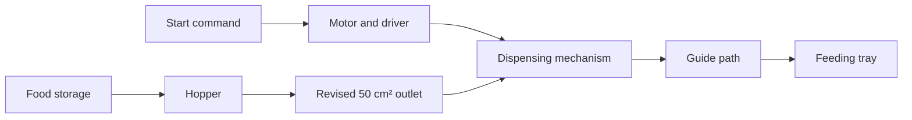

# Automatic Cat Feeder

**[Mechanical Design](docs/mechanical-design.md) · [Motor & Automation](docs/motor-and-automation.md) · [Food Preservation](docs/food-preservation.md) · [Download CAD](cad/automatic_cat_feeder_assembly.step)**

Automatic Cat Feeder is a multidisciplinary Alba Studio project that stores dry cat food and dispenses it into a feeding tray. I led the mechanical work: creating the 40-instance CAD assembly, planning dimensions, sourcing materials, fabricating parts, assembling the structure, and improving the food path through physical testing.

## Project Videos

### Completed Feeder Prototype

<video src="https://github.com/user-attachments/assets/3802f599-0b08-426b-a826-65936d58fb92" controls width="620"></video>

### Higher-Torque Motor Test

<video src="https://github.com/user-attachments/assets/d001d56f-1696-4ed1-9d0b-61fb5bd48209" controls width="620"></video>

## How It Works

The upper container directs food into the hopper. When the motor turns the dispensing mechanism, a controlled quantity passes through the revised outlet and guide path before falling into the tray.

## Mechanical Design and Improvement

The original CAD model established the storage container, hopper, frame, guide rails, dispensing mechanism, and feeding tray. After the first full assembly, testing revealed repeated jamming and leakage around the hopper outlet. I reduced the opening to **50 cm²** and reshaped the surrounding food path, producing smoother and more controlled dispensing.

| Design evidence | Result |
| --- | --- |
| CAD assembly | 40 component instances with planned relationships and dimensions |
| Physical fabrication | Complete cut, machined, and assembled mechanical structure |
| Main failure identified | Food jammed and leaked near the original outlet |
| Final mechanical revision | Smaller outlet and redesigned guide path |

The complete model is available as a [downloadable STEP assembly](cad/automatic_cat_feeder_assembly.step). More fabrication and testing details are in [Mechanical Design](docs/mechanical-design.md).

## Motor Iteration

The first NEMA17 system could be controlled successfully but did not provide enough torque under the food load. A higher-torque motor and CL86Y-V20 driver were then tested with acceleration, deceleration, direction control, and software stop commands. The replacement motor could drive the mechanism, but its approximately **5 kg** mass created a tipping risk, so it was kept separate from the feeder frame rather than permanently mounted.

The controller code and technical notes are organized under [Motor & Automation](docs/motor-and-automation.md).

## Contributions

| Contributor | Contribution |
| --- | --- |
| **Shuoqi Yang** | Mechanical design, dimensional planning, material sourcing, fabrication, assembly, food-flow testing, and mechanical redesign |
| **[Shaoxuan Xiong](https://github.com/yuxuan-518)** | Motor control, electrical testing, automation code, and documentation of both motor configurations |
| **[Wenhao Jia](https://github.com/jw3422951-ops)** | Chemistry and food-preservation study, to be documented through his contributor submission |

## Repository Guide

- [`docs/mechanical-design.md`](docs/mechanical-design.md) — CAD, fabrication, assembly, and food-flow redesign
- [`docs/motor-and-automation.md`](docs/motor-and-automation.md) — NEMA17 and higher-torque motor iterations
- [`docs/food-preservation.md`](docs/food-preservation.md) — contributor-owned preservation study
- [`cad/automatic_cat_feeder_assembly.step`](cad/automatic_cat_feeder_assembly.step) — complete CAD assembly
- [`code/nema17_motor/`](code/nema17_motor/) and [`code/high_torque_motor/`](code/high_torque_motor/) — controller source code
